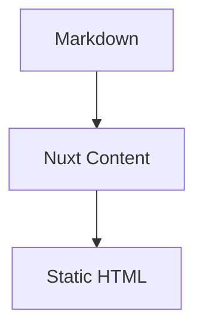

Phase 0 静态生成验证正文：这篇文章必须完整出现在生成后的 HTML 里。

正文同时包含英文关键词 static generation proof。

## 能力对照

| 能力 | 结果 |
| --- | --- |
| Content 3 | 已解析 |
| 静态生成 | 已验证 |

## 自定义 MDC 组件

::callout
这是一条 MDC Callout，用于验证自定义组件已进入静态 HTML。
::

## Shiki 代码高亮

```ts
export function resolveImageUrl(path: string): string {
  return path
}
```

## KaTeX 公式

行内公式 $E = mc^2$。

$$
\int_{0}^{1} x^{2} \, dx = \frac{1}{3}
$$

## Mermaid 图表



## 内部链接

返回 [首页](/)。
